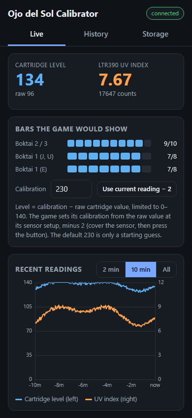
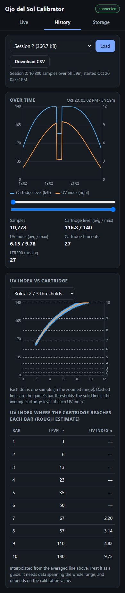
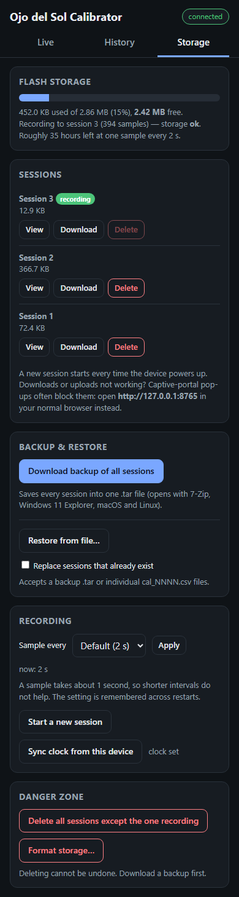

I've done this all at my own expense.\
Please consider donating via...

<a href="https://ko-fi.com/TideGear"></a> or 
<a href="https://www.paypal.com/donate/?hosted_button_id=THMF458QTBCAL"></a>

https://ko-fi.com/TideGear

https://www.paypal.com/donate/?hosted_button_id=THMF458QTBCAL

----------------------------------------------------------------------

**Important!: This project is all very new, experimental, lightly-tested, and subject to change.\
I'm looking for serious contributors to...**

**1. Help tune the default device settings to *exactly* match how all three games handle a range of sunlight.** The defaults are roughly calibrated against real sunlight and a real Boktai 3 cartridge, but more testing across conditions and games is welcome. Where testing is ambiguous (e.g. flickering meter bar in the game), I tend to skew toward whatever is more "challenging" to achieve (seeking out more sunlight). The Ojo del Sol is meant to be the "no cheating" solution. However, keep in mind, I am talking about nit-picky, fractions of UVI.\
**2. Add support via Single Analog Control Mode to their emulators.**\
**3. Test and fix the code if needed.**\
**4. Create a cool 3D-printable case.**\
**5. You tell me!**

**...so please contact me if you are interested at TideGear @at@ gmail .dot. com !**

**Also contact me if you want to buy a pre-assembled device or kit!**

Photos of a build: https://photos.app.goo.gl/MvNCn2qLSqU6MgfA8 \
Made with this 1.7 x 1.7 x 0.79 inch case: https://a.co/d/01qMPdr9

----------------------------------------------------------------------

Ojo del Sol - ESP32-S3 UV Meter for Boktai Games
======================================================================

A substitute solar sensor for playing the Boktai series (Boktai 1, 2, 3)
on flash carts or emulators. Restores "Kojima's Intent" by using real
sunlight (UV) instead of artificial light hacks.

### Based on Prof9's Work

The GBA link cable ASM patches, IPS patches, and Ojo-del-Sol-side GBA link
protocol are based on [the gba-link-gpio branch of Prof9's Boktai Solar Sensor Patches](https://github.com/Prof9/Boktai-Solar-Sensor-Patches/tree/gba-link-gpio/Source).
Prof9's original code is released under the MIT License — see
[Prof9's license.txt](Prof9's%20license.txt) for details.

**Supported Games:**
- Boktai 1: The Sun Is in Your Hand (8-bar gauge)
- Boktai 2: Solar Boy Django (10-bar gauge)
- Boktai 3: Sabata's Counterattack (10-bar gauge)

----------------------------------------------------------------------

## Quick Start

**Recommended setup:** Incremental Mode (`HID_CONTROL_MODE = 0`) with mGBA libretro core (RetroArch), over either Bluetooth or USB XInput

1. Build the hardware (see [Hardware](#hardware) below)
2. Flash the firmware (see [Firmware Setup](#firmware-setup))
3. For mGBA libretro, set `HID_CONTROL_MODE = 0` in `config.h`
4. Pair the device as a Bluetooth controller in your OS
5. In mGBA (libretro), map **L3** to solar sensor decrease and **R3** to increase
6. Power on: hold button 2 seconds
7. Tap button to select game (BOKTAI 1, 2, or 3). (Optional) Tap to the **XInput** screen to view UV raw, UVI, compensated UVI, ADC avg, and battery voltage.
8. Point sensor toward the sky — the device syncs the in-game meter automatically
9. Hold button 2 seconds on a game screen to sleep. On the **XInput** screen, hold 2 seconds to enter CDC mode (USB serial / firmware upload).

**Important:** Only wake the device once you are in-game. The controller inputs it sends (button presses, stick deflections) may cause unwanted behavior in menus or other apps. When possible, put the device to sleep (hold 2s) when you are not actively playing a Boktai game.

**Important:** Placing the sensor behind standard glass or plastic blocks UV light. Use the `UV_ENCLOSURE_*` settings in `config.h` to compensate for your enclosure window. Strongly UV-blocking materials can still reduce usable range. The default transmittance (0.833) is currently a very quick and dirty calibration for these boxes: https://a.co/d/092sVvLT — adjust if you use a different enclosure.

----------------------------------------------------------------------

## Output Modes

The Ojo del Sol can output bar values in four ways. Choose based on your setup:

### 1. Bluetooth (Recommended for Emulators on PC or Mobile)
The device appears as an Xbox Series X controller ("Ojo del Sol Sensor") and sends button/stick inputs to control the emulator's solar sensor.

**Two HID control modes** (shared by Bluetooth and USB XInput; set via `HID_CONTROL_MODE` in config.h):

| Mode | How it works | Emulator support |
|------|--------------|------------------|
| **Incremental (default, mode 0)** | Sends L3/R3 button presses to step the meter up/down | **Works now** with mGBA libretro core |
| **Single Analog (mode 1)** | Better for Ojo del Sol! Maps bar count to proportional deflection on one analog axis | Requires emulator support |

**Current recommendation:** Use **Incremental Mode** with the **mGBA libretro core** in RetroArch until Single Analog Mode is supported by emulators (transport can be Bluetooth or USB XInput).

**Emulator developers:** See [For Emulator Devs.md](For%20Emulator%20Devs.md) for the Single Analog Mode specification, band mapping tables, and pseudocode.

### 2. USB XInput (Also Great for Emulators on PC or Mobile)
When `USB_HID_ENABLED = true`, normal boot enumerates as an Xbox 360-compatible USB XInput device (product string: `Ojo del Sol`) for emulator/game compatibility.
When `USB_HID_ENABLED = false`, the device automatically enters CDC mode on boot (one brief restart on first power-on or after a full power cycle; subsequent wakes return directly to CDC).
Both HID control modes are available over USB:
- **Incremental (`HID_CONTROL_MODE = 0`)**: sends `HID_BUTTON_DEC`/`HID_BUTTON_INC` step inputs and works independently of BLE state.
- **Single Analog (`HID_CONTROL_MODE = 1`)**: sends the configured axis plus optional unlock button (`HID_SINGLE_ANALOG_AXIS`, `HID_METER_UNLOCK_*`).

USB CDC serial is not active during normal XInput runtime. To enable USB serial (for `DEBUG_SERIAL` output or firmware upload):
1. Tap to the **XInput** screen (last screen in the cycle; this diagnostics screen is always present).
2. Hold the button for 2 seconds.
3. The device restarts into CDC mode and enumerates as `Ojo del Sol (CDC)`.

With `DEBUG_SERIAL = true`, CDC output includes startup diagnostics, device-button press events, and any enabled UV/battery debug streams.

In CDC mode the firmware runs fully (UV sensing, game display, screensaver, BLE, GBA link). The screen header shows **CDC** instead of **XInput**. Hold the button for 2 seconds from any screen to exit CDC mode and sleep; on next wake, the device boots back into XInput mode.

As an alternative, set `USB_HID_ENABLED = false` to have the firmware boot directly into CDC on wake.

### 3. GBA Link Cable (Best Option for Flash Carts)

This outputs a framed 3-wire value (SC + SD + SO) for use with a physical GBA via link cable. Supported on both boards (on the T-QT Pro it uses the board-edge solder pads IO16/IO17/IO18).

**Requirements:**
- Use the updated ROM hack IPS patches in this repo's `GBA Link Patches/` folder (`Source/` contains the ASM sources). Many thanks to Prof9 for the original proof-of-concept code!
- Recommended: install a real GBA link port on the Ojo del Sol and wire it as shown in [GBA Link Port Wiring.png](GBA%20Link%20Port%20Wiring.png). Link ports can be ordered here: https://a.co/d/00r3xzuj
- A breakout board also works, but the link cable can come loose easily if you move around much, so the real link port is the more robust option.
- Connect the Ojo del Sol to the **Player 1 (P1)** side of the cable and the GBA to the **Player 2 (P2)** side.

**Note:** The English translation of Boktai 3 should work with the patch, but this is currently untested.

**Limitation:** Boktai's normal link-cable modes (e.g., multiplayer) are **not compatible** with this and may never be. To use multiplayer alongside the Ojo del Sol, you'll need an emulator with link support (I've contacted Pizza Boy A Pro and Linkboy devs — TBD).

### 4. Display Only / Manual Entry (Not Recommended)
Read the bar count from the OLED and enter it manually using Prof9's ROM hacks (https://github.com/Prof9/Boktai-Solar-Sensor-Patches). If you intend to use manual entry, **do not** use the ROM hacks in the GBA Link Patches directory. Those are for the GBA link cable method above.

**Note:** The screen is difficult to read in direct sunlight unless you shade it, so the display is really more for calibration and occasional reference.

----------------------------------------------------------------------

## Hardware

Two boards are supported. Select yours at the top of `config.h` (`BOARD_SEEED_XIAO_ESP32S3` is the default; uncomment `BOARD_LILYGO_T_QT_PRO` instead for the T-QT Pro, which is currently experimental/untested — see Option B below).

### Option A: Seeed XIAO ESP32S3 (original build)

**Components:**
- Seeed XIAO ESP32S3 (built-in LiPo charging)
- Adafruit LTR390 UV Sensor (I2C)
- SSD1306 128x64 OLED Display (I2C)
- Tactile push button (power/game select)
- 3.7V LiPo battery (300mAh works well; larger capacity is optional but be mindful of your case size)
- 2x 100K ohm resistors (for battery monitoring — optional but recommended)

### Option B: LilyGO T-QT Pro (minimal-wiring build) — EXPERIMENTAL / UNTESTED

> **Warning:** The T-QT Pro build is currently **untested on real hardware** and should be considered experimental. Pin assignments follow LilyGO's official pinmap and schematic, but nothing below has been verified on an actual unit yet. If you try it, expect to troubleshoot — and please report results (working or not) via a GitHub issue.

The [LilyGO T-QT Pro](https://github.com/Xinyuan-LilyGO/T-QT) has a built-in 0.85" 128x128 GC9107 color TFT, two buttons, battery charging, and battery voltage sensing — so the only wiring needed is the LTR390 and a battery.

**Components:**
- LilyGO T-QT Pro (ESP32-S3)
- Adafruit LTR390 UV Sensor (I2C) — connects to the T-QT's Qwiic connector; Adafruit's STEMMA QT version plugs straight in with a Qwiic/STEMMA QT cable, no soldering
- 3.7V LiPo battery (solder to the battery pads or use the connector, depending on your unit)

**T-QT Pro notes:**
- If you wire to the Qwiic connector manually instead of using a cable: SDA = GPIO43, SCL = GPIO44. (Beware: the pinout image and board silkscreen swap the Qwiic SDA/SCL labels; SDA = GPIO43, SCL = GPIO44 matches the schematic and actually works — [details](https://github.com/Xinyuan-LilyGO/T-QT/issues/17).)
- **Solder-pad sensor option:** set `I2C_SDA_PIN = 33` and `I2C_SCL_PIN = 34` in `config.h` to wire the sensor to the IO33/IO34 pads instead, freeing the Qwiic connector. I2C then needs pull-ups on SDA/SCL; the Adafruit LTR390 breakout includes 10K pull-ups on board, so no extra parts are needed with it.
- GBA link output is supported via the board-edge solder pads: IO16 (SC), IO17 (SD), IO18 (SO), plus the adjacent GND pad. See [GBA Link Cable Wiring](#gba-link-cable-wiring-optional).
- Battery sensing is built in (2:1 divider on GPIO4) and enabled by default; no resistors needed.
- **Right button (GPIO47)** advances to the next screen (BOKTAI 1 → 2 → 3 → XInput). **Left button (GPIO0)** is the power button (hold 2s) — it is the only button that can wake the board from deep sleep — and a tap on it cycles screens backward.
- The UI renders as a 128x64 region centered on the square screen (top/bottom letterboxed). Set `TQT_DISPLAY_ROTATION` in `config.h` if your case orientation needs the screen flipped.

### Wiring

*(XIAO ESP32S3 build only — the T-QT Pro just needs the LTR390 on the Qwiic connector (or the IO33/IO34 pads, see above), a battery, and the GBA link pads below if you use that output.)*

| Component | Pin | XIAO ESP32S3 | Notes |
|-----------|-----|--------------|-------|
| OLED VIN | | 3V3 | 3.3V power |
| OLED GND | | GND | |
| LTR390 VIN | | 3V3 | 3.3V power |
| LTR390 GND | | GND | |
| OLED + LTR390 SDA | | D4 (GPIO5) | I2C data (configurable via `I2C_SDA_PIN`) |
| OLED + LTR390 SCL | | D5 (GPIO6) | I2C clock (configurable via `I2C_SCL_PIN`) |
| Button | Leg A | D0 (GPIO1) | Signal (internal pull-up) |
| Button | Leg B | GND | |
| Battery + | | BAT+ (back pad) | Farthest from USB-C |
| Battery - | | BAT- (back pad) | Closest to USB-C |

### Battery Monitoring (Optional)

The XIAO doesn't expose battery voltage directly. To enable battery percentage display, add a voltage divider:

```
BAT+ ----[100K]----+---- D1 (GPIO2)
                   |
                 [100K]
                   |
GND ---------------+
```

Battery sensing is disabled by default (`BATTERY_SENSE_ENABLED = false`). After wiring the divider, set `BATTERY_SENSE_ENABLED = true` in `config.h` to show battery data.

**Calibration:** If battery % is wrong at full charge, adjust `VOLT_DIVIDER_MULT` in config.h (increase if reading low, decrease if high).

### GBA Link Cable Wiring (Optional)

Only needed if using GBA Link output mode. Recommended: install a real GBA link port on the Ojo del Sol and wire it as shown in [GBA Link Port Wiring.png](GBA%20Link%20Port%20Wiring.png). Link ports can be ordered here: https://a.co/d/00r3xzuj

A breakout board such as the [Palmr breakout board](https://github.com/Palmr/gb-link-cable) still works, but the link cable can come loose easily if you intend to move around much. An actual link port is a much more robust solution.

**Recommended Ojo-side link port wiring (XIAO ESP32S3):**

| Ojo Connection | Ojo-side GBA Port Pin Type | Equivalent P1 Breakout Pad | Notes |
|----------------|----------------------------|----------------------------|-------|
| D9 (GPIO8) | SI | SO | Payload bit 0 |
| GND | GND | SI | Shared ground |
| D8 (GPIO7) | SD | SD | Payload bit 1 |
| D7 (GPIO44) | SC | SC | Frame phase; toggles every `GBA_LINK_FRAME_TOGGLE_MS` |

**Recommended Ojo-side link port wiring (T-QT Pro):** same as above, using the board-edge solder pads next to the GND pad:

| Ojo Connection | Ojo-side GBA Port Pin Type | Equivalent P1 Breakout Pad | Notes |
|----------------|----------------------------|----------------------------|-------|
| IO18 pad | SI | SO | Payload bit 0 |
| GND pad | GND | SI | Shared ground |
| IO17 pad | SD | SD | Payload bit 1 |
| IO16 pad | SC | SC | Frame phase; toggles every `GBA_LINK_FRAME_TOGGLE_MS` |

Leave the Ojo-side port `SO` and `VDD35` contacts unconnected. If you use a breakout board instead of a port, wire the equivalent P1 breakout pads listed above.

**Cheap cable continuity and cable orientation:**

Cheap GBA link cables have non-standard internal wiring (no mid-cable signal splitter), and the two ends are not equivalent. Plug the Ojo del Sol into the **Player 1 (P1)** side of the cable and the GBA into the **Player 2 (P2)** side.

Verify your specific cable's wiring with a multimeter continuity test. See [this sheet](https://docs.google.com/spreadsheets/d/19uAjLaDji9D3lIKIEdB9RHNQ_F-Fo1NnXY90uRH3dQA/edit?usp=sharing) for reference.

Expected continuity on this cheap-cable variant:
- P1 Pin 2 -> P2 Pin 3
- P1 Pin 3 -> P2 Pin 6
- P1 Pin 4 -> P2 Pin 4
- P1 Pin 5 -> P2 Pin 5

This wiring intentionally uses the conductor that routes P1 Pin 3 to P2 Pin 6 as the shared ground path between the Ojo and GBA.

**Important - shield and "GND" labels:**

- Shell/shield continuity is often missing on cheap cables, so do not assume shield gives ground reference.
- On this wiring method, shared ground comes from the P1 Pin 3 conductor routed to P2 Pin 6.

**`GBA_LINK_FRAME_TOGGLE_MS` explained:**

- This value is the hold time for one frame phase (`SC` low or high).
- One full 4-bit bar value needs two phases, so ideal full refresh time is roughly `2 * GBA_LINK_FRAME_TOGGLE_MS`.
- Firmware schedules phase timing with a microsecond clock, so `GBA_LINK_FRAME_TOGGLE_MS` is now honored much more closely than simple loop-delay timing.
- Example: `5ms` targets about `10ms` per full value (~100 full updates/sec), subject to normal loop jitter.
- Lower values respond faster but reduce electrical timing margin; higher values are slower but more tolerant.

**Notes:**
- Keep all signals at 3.3V logic (both supported boards are 3.3V native, so no level shifting is needed)
- The ESP32 writes data pins (SD, SO) before the phase pin (SC) so the GBA always samples stable data when it detects a phase edge. The GBA-side ASM patches include a consecutive-match check that discards any single-frame misread, adding one frame (~17ms) of latency on real bar changes but eliminating visible glitches.


----------------------------------------------------------------------

## Firmware Setup

### Libraries Required

**Install via Arduino Library Manager:**
- Adafruit LTR390 Library
- Adafruit SSD1306 (XIAO build only)
- Adafruit GFX Library
- Adafruit BusIO
- NimBLE-Arduino (by h2zero)
- Callback (by Tom Stewart)
- GFX Library for Arduino (by moononournation, a.k.a. Arduino_GFX) — **T-QT Pro build only**; no configuration needed, the display pins are fixed board wiring set in `TQTDisplay.h`

**Install manually (included in repo as ESP32-BLE-CompositeHID-master.zip, or download from GitHub):**
- ESP32-BLE-CompositeHID: https://github.com/Mystfit/ESP32-BLE-CompositeHID

**Why not TFT_eSPI (which LilyGO's own T-QT samples use)?** TFT_eSPI's last release (2.5.43) crashes in `tft.init()` on the ESP32-S3 under esp32 core 3.x (StoreProhibited panic → boot loop; [known issue](https://github.com/Bodmer/TFT_eSPI/issues/3329)). LilyGO's samples work because they bundle a modified TFT_eSPI and target the older 2.0.x core, but this project requires core 3.x. Arduino_GFX supports the GC9107 natively on current cores.

### Board Settings (Arduino IDE)

- **Boards Manager URL:** `https://raw.githubusercontent.com/espressif/arduino-esp32/gh-pages/package_esp32_index.json`
- **Board package:** esp32 by Espressif Systems
- **Recommended version:** `3.3.7`
- **Board:**
  - XIAO build: **XIAO_ESP32S3**
  - T-QT Pro build: **ESP32S3 Dev Module** (no T-QT entry exists in the ESP32 core) with these settings — everything not listed stays at its default:
    - **Flash Size:** 4MB (32Mb) for the common N4R2 variant; 8MB (64Mb) for the N8 variant (chip marking `ESP32-S3FN4R2` = N4R2)
    - **PSRAM:** QSPI PSRAM (N4R2) or Disabled (N8)
    - **Partition Scheme:** Huge APP (3MB No OTA/1MB SPIFFS) — the sketch is too large for the default 1.2MB app partition
    - **Flash Mode:** QIO 80MHz, **CPU Frequency:** 240MHz, **Events/Arduino Run On:** Core 1
    - USB settings identical to the XIAO build (below)
- **USB Mode:** USB-OTG (TinyUSB)
- **USB CDC On Boot:** Enabled (required for CDC mode; normal runtime remains XInput unless you enter CDC mode from the XInput screen or set `USB_HID_ENABLED = false`)
- **Upload Mode:** USB-OTG CDC (TinyUSB) (required for CDC-mode uploads; UART0/Hardware CDC will fail to auto-connect in this setup)
- If CDC UI appears inconsistent/garbled after failed uploads, do one upload with **Erase All Flash Before Sketch Upload = Enabled**, then set it back to Disabled.
- Remember to select your board at the top of `config.h` as well (`BOARD_SEEED_XIAO_ESP32S3` or `BOARD_LILYGO_T_QT_PRO`).

----------------------------------------------------------------------

## Usage

### Button Controls

**When device is ON:**
- **Tap:** Cycle screens (BOKTAI 1 → 2 → 3 → XInput → 1...). The XInput screen is always present and doubles as the diagnostics screen.
- **Hold 2s on a game screen:** Power OFF (deep sleep, ~10uA)
- **Hold 2s on the XInput screen:** Restart into CDC mode for USB serial output and firmware upload
- **Hold 2s while in CDC mode:** Exit CDC mode and sleep (next wake returns to XInput mode)
- If screensaver is active, first tap wakes the screen

**When waking from sleep:**
- **Hold 2s:** Power ON
- **Short press/tap:** Immediately shows "Hold 2s to power on"
- If there is no button activity for 10 seconds, it returns to sleep

**T-QT Pro:** The **right button** advances to the next screen when the device is on; it has no long-press action and cannot wake the device from sleep (hardware limitation — only GPIO0 is wake-capable). The **left button (GPIO0)** handles everything else described above (hold 2s for power/CDC), except its tap cycles screens *backward* instead of forward. Directions are configurable via `BUTTON_TAP_STEP`/`BUTTON2_TAP_STEP` in config.h.

### HID Control Mode Details (Bluetooth + USB)

**Incremental Mode specifics:**
- Works over both Bluetooth and USB XInput.
- The firmware tracks the in-game meter state and sends L3/R3 presses to sync it
- On BLE connections, performs a clamp+refill resync every `BLE_RESYNC_INTERVAL_MS` (default 60s)
- Press rate controlled by `HID_BUTTONS_PER_SECOND` (default 20)
- For Boktai 1, mGBA uses 10 internal steps despite 8 visible bars — the firmware compensates (disable via `HID_BOKTAI1_MGBA_10_STEP_WORKAROUND = false` if fixed)
- **Button remapping:** Change `HID_BUTTON_DEC` and `HID_BUTTON_INC` in config.h to use different buttons (see `XboxGamepadDevice.h` for available constants)

**Single Analog Mode specifics:**
- Works over both Bluetooth and USB XInput.
- Updates immediately on bar change (no rate throttling)
- Maps bar count to a proportional deflection on a configurable analog axis (default: Right X+)
- Optionally holds a configurable "meter unlock" button (default: R3) while the axis is active (`HID_METER_UNLOCK_BUTTON_ENABLED`). Single Analog mode uses midpoint band mapping, so even 0 bars sends a small deflection (not exact center).
- Bluetooth path: the unlock button is released/re-pressed on each deflection change and periodically (`HID_METER_UNLOCK_REFRESH_MS`, default 1000ms) so apps/emulators that start listening late can still register it as held.
- USB path: the unlock button is held while active and updated with normal USB reports (no periodic release/re-press refresh cycle).
- Axis and unlock button are configurable in config.h (`HID_SINGLE_ANALOG_AXIS`, `HID_METER_UNLOCK_BUTTON`)

### Bluetooth-Specific Details

The device advertises as "Ojo del Sol Sensor" (configurable via `BLE_DEVICE_NAME`).

**Pairing/connection behavior:**
- Times out after `BLE_PAIRING_TIMEOUT_MS` (default 60s)
- Re-enters pairing if connection drops
- **Pairing restarts on wake** — after waking from sleep, the device re-advertises for pairing
- Bluetooth icon flashes while pairing, solid when connected

### Screensaver

After `SCREENSAVER_TIME` minutes (default 3) of no button activity, the display shows a bouncing "Ojo del Sol" logo. Press any button to wake. Set `SCREENSAVER_TIME = 0` to disable (but this affects OLED lifespan). Alternatively, set `SCREENSAVER_ACTIVE = false` to disable it without changing the time value. The status row appears only when battery data is available and/or BLE is actively connected or pairing.

----------------------------------------------------------------------

## Calibration

### Automatic Mode (Default)

Bar thresholds are calculated from two values in config.h:

```c
const bool AUTO_MODE = true;
const float AUTO_UV_MIN = 1.000;   // UV Index for 1 bar
const float AUTO_UV_SATURATION = 13.100;   // UV Index ceiling (output clamp)
```

Bars are distributed non-linearly following the original Boktai cartridge's thresholds (per [Raphi's sensor graph](https://raphi.xyz/~raphi/boktai/sensor_graph/)), scaled across the configured UV range. `AUTO_UV_MIN` is where bar 1 starts; `AUTO_UV_SATURATION` is where the highest bar starts (and all values above are clamped to max).

**Original cartridge bar thresholds** (0–140 scale; source: [raphi.xyz/~raphi/boktai/sensor_graph/](https://raphi.xyz/~raphi/boktai/sensor_graph/)):

```
Exclusive upper bound
Bars    Boktai 1    Boktai 2 & 3
0       1           1
1       7           6
2       16          13
3       28          23
4       44          35
5       67          50
6       98          67
7       140         87
8       (max)       110
9       —           140
10      —           (max)
```

The Boktai 1 column above matches the Japanese and US releases. **Boktai 1 (E)** (Europe) uses different thresholds, found by disassembling the ROM's bar-ladder routine (the first value at which each bar starts, in the same 0–140 scale):

```
Bars    Boktai 1 (E)
1       1
2       7
3       15
4       25
5       38
6       56
7       98
8       140
```

This differs from Raphi's Boktai 1 table (bars 3–6 start at 16, 28, 44 and 67 there). The config.h thresholds follow Raphi's table, so they do not reproduce the European release's gauge exactly.

`AUTO_UV_MIN` maps to scaled value 1 and `AUTO_UV_SATURATION` maps to 140.

### Manual Mode

Set `AUTO_MODE = false` to use per-game `BOKTAI_1/2/3_UV_MIN` and `BOKTAI_1/2/3_UV_SATURATION` values (`BOKTAI_1_UV_MIN`, `BOKTAI_1_UV_SATURATION`, etc.). Bar thresholds follow the same non-linear cartridge curve as AUTO mode, but each game can use a different UV range.

### Transparent Enclosure Compensation

If the sensor is behind a transparent window, model that window as transmission loss:

```c
const bool UV_ENCLOSURE_COMP_ENABLED = true;
const float UV_ENCLOSURE_TRANSMITTANCE = 0.42; // 42% UV passes through the window
const float UV_ENCLOSURE_UVI_OFFSET = 0.000;     // Optional bias correction
```

The current repo default in `config.h` is `0.833`, based on the enclosure linked above; expect to recalibrate this value for your own case/window material.

Firmware applies compensation once after raw-to-UVI conversion:

`corrected_uvi = max(0, (measured_uvi - offset) / transmittance)`

Quick calibration:
1. Temporarily set `UV_ENCLOSURE_COMP_ENABLED = false` while collecting calibration readings.
2. Take side-by-side readings at the same time/angle: one sensor open-air, one in-box.
3. Compute `in_box_uvi / open_air_uvi` across several samples.
4. Use the median ratio as `UV_ENCLOSURE_TRANSMITTANCE`.
5. Re-enable compensation (`UV_ENCLOSURE_COMP_ENABLED = true`).

**Threshold calibration mode:** By default (`UV_THRESHOLDS_CALIBRATED_OPEN_AIR = true`), all threshold values in config.h (`AUTO_UV_MIN`, `AUTO_UV_SATURATION`, and the per-game `BOKTAI_*_UV_MIN`/`BOKTAI_*_UV_SATURATION` values) are assumed to be open-air UVI values — set while the case is open or without an enclosure. The firmware compensates sensor readings to open-air equivalent before comparing against them. Set `UV_THRESHOLDS_CALIBRATED_OPEN_AIR = false` if you instead calibrated thresholds with the sensor inside the closed enclosure; bar comparison will then use the raw (uncompensated) reading directly.

For open-air builds (sensor always exposed when device is in use): set `UV_ENCLOSURE_COMP_ENABLED = false` and leave `UV_THRESHOLDS_CALIBRATED_OPEN_AIR = true`. Compensation is a no-op so raw equals compensated.

Note: On the XInput screen, `UVI` is the measured (pre-compensation) value and `UVI comp'ed` is the value used for bar calculation (post-compensation; post-smoothing if `UVI_SMOOTHING_ENABLED = true`).

### Stability Tuning

If the bar display feels jumpy:
- `UVI_SMOOTHING_ENABLED`: Applies exponential smoothing (default: `false`; set `true` to smooth)
- `UVI_SMOOTHING_ALPHA`: Controls how much weight new readings get vs. the running average (default: `0.5`; higher = faster response, lower = smoother). Setting `UVI_SMOOTHING_ALPHA = 1.0` is the same as `UVI_SMOOTHING_ENABLED = false`.
- `BAR_HYSTERESIS_ENABLED`: Enables bar hysteresis (default: `false`). Setting `BAR_HYSTERESIS_ENABLED = false` is the same as `BAR_HYSTERESIS = 0.0`.
- `BAR_HYSTERESIS`: Requires UV margin before changing bars (default: `0.200`; only used when `BAR_HYSTERESIS_ENABLED = true`)

----------------------------------------------------------------------

## Ojo del Sol Calibrator — UNTESTED

> **Status: untested.** The firmware in `OjoDelSolCalibrator/` compiles for the ESP32-S3 (esp32 core 3.3.11), but it has **never been run on real hardware**. The cartridge-bus wiring and timing, the flash logging, the Wi-Fi hotspot and the serial commands are all unverified. The web page was only tried in a desktop browser against a mock of the device's API (see [Web app](#web-app-wi-fi-hotspot)), never served by the board. The sensor-reading method itself was checked against a Boktai 3 (J) ROM and against a GBxCart RW, but not on this board. Expect to debug it, and please report what works and what doesn't.

A separate device that reads a **real Boktai cartridge's solar sensor** and an **LTR390** at the same moment, and saves both to the board's flash. Leave it in the sun for hours, then watch it live, browse past sessions and back up the logs from your phone over its own Wi-Fi hotspot (or over serial). This is the data needed to tune `AUTO_UV_MIN`, `AUTO_UV_SATURATION` and the bar thresholds against the real hardware.

**What it logs** (one CSV row per sample, once per second by default):

| Column | Meaning |
|--------|---------|
| `uptime_ms` | Milliseconds since power-up. The device has no clock of its own; when a phone opens the web app it sends the real time, and the log then gets a `# time_sync,<uptime_ms>,<epoch_ms>` comment line that maps uptime to wall-clock time |
| `cart_status` | `ok`, or `timeout` if the cartridge's flag never rose (no cartridge, or a wiring fault) |
| `cart_raw` | The game's raw sensor value. About 230 in the dark, falling toward 0 as it gets brighter |
| `cart_bus` | `1` if the cartridge's GPIO registers read back what was written (a wiring check) |
| `cart_ms` | How long the cartridge read took |
| `ltr_status` | `ok`, `stale` (no fresh reading) or `absent` |
| `ltr_raw`, `uvi` | LTR390 UV counts and `counts / 2300` (same settings as the main firmware) |

### Hardware

Written for an **ESP32-S3-CAM board with the camera unused** (any ESP32-S3 works if you change the pins in `OjoDelSolCalibrator/config.h`). The pins avoid PSRAM, the strapping pins, native USB and UART0.

| Signal | GPIO |
|--------|------|
| Cartridge /WR, /RD, /CS | 21, 47, 38 |
| Cartridge AD0, AD1, AD2, AD3 | 39, 40, 41, 42 |
| Cartridge AD5, AD6 | 2, 1 |
| LTR390 SDA, SCL | 4, 5 |

**Wire routing:** the whole cartridge bus is on the board's **right-hand header**. Hold the board with the USB-C ports at the bottom; the usable pins from the bottom up are GPIO **21, 47, 38, 39, 40, 41, 42, 2, 1**, which is exactly the cartridge pin order /WR, /RD, /CS, AD0, AD1, AD2, AD3, AD5, AD6. Run the nine wires in that order and none cross (the gaps between 47 and 38, and between 42 and 2, hold pins you can't use: GPIO48 is the on-board LED, 0/45 are strapping pins, 35–37 are PSRAM, 43/44 are the serial port). This direction also keeps the active-low /WR, /RD and /CS off GPIO1–14, which give a ~60 µs low pulse at power-up. The LTR390's SDA/SCL stay on the left header next to 3V3. GPIO39–42 are also the JTAG pins and GPIO38/39/40 are the SD card's CMD/CLK/DATA, so leave the SD slot empty. GPIO4/5 are the camera's control bus; the LTR390 (0x53) does not collide with the camera (0x30).

**Cartridge wiring** — the cartridge is 3.3 V like the ESP32, so no level shifter is needed. Only the lines needed to reach the GPIO registers at 0x080000C4–C8 are driven, so the rest are tied off:

| Cartridge pin(s) | Connect to |
|------------------|------------|
| VCC (pin 1) / GND (pin 32) | 3V3 / GND |
| /WR (3), /RD (4), /CS (5) | the three GPIOs above. A ~10 k pull-up to 3V3 on each is **optional**: it only keeps them idle while the ESP32 boots |
| AD0–AD3, AD5, AD6 (pins 6–9, 11, 12) | the six GPIOs above |
| AD4 (pin 10) and AD7–AD15 (pins 13–21) | each through ~10 k to GND (a bussed resistor network works too). These must be held low when the address is latched. A direct tie to GND should also work, because the cartridge drives zeros on these lines for the GPIO registers, but the resistors protect against the cartridge ever driving a 1 into ground |
| A16–A23 (pins 22–29) | GND |
| /CS2 (pin 30) | 3V3, wired directly (keeps the save RAM deselected; it is an input on the cartridge, so no resistor is needed) |
| CLK (pin 2), /IRQ (pin 31) | leave unconnected |

The pin numbers match the GBA cartridge edge connector pinout in [`References/gba_cartridge_pinout.svg`](References/gba_cartridge_pinout.svg). The full wiring, including the resistors, is drawn in [`OjoDelSolCalibrator/Ojo del Sol Calibrator Wiring.svg`](OjoDelSolCalibrator/Ojo%20del%20Sol%20Calibrator%20Wiring.svg). Power the board off before inserting or removing the cartridge.


### Firmware setup

- Open `OjoDelSolCalibrator/OjoDelSolCalibrator.ino` (the folder name must match the sketch). The sketch is several files in that folder (`WebApp.ino`, `WebPage.h`, `GbaCartSensor.h`, `Shared.h`, `config.h`, `partitions.csv`); Arduino builds them together, so keep them all together.
- Libraries: **Adafruit LTR390 Library** (plus Adafruit BusIO). LittleFS, Preferences, WiFi, WebServer and DNSServer come with the esp32 core. There are no external web libraries and the web app needs no internet.
- Board: **ESP32S3 Dev Module**, with **Flash Size: 16MB**, **Partition Scheme: Custom** (this uses the `partitions.csv` in the sketch folder) and **USB CDC On Boot: Disabled** (the default, so Serial stays on UART0 / the TTL port). **PSRAM** can stay Disabled or be set to *OPI PSRAM* for boards that have it; the sketch does not use PSRAM either way, and the pins avoid GPIO 33–37, which octal PSRAM occupies. These are the same board settings as in the Metal-Gear-Mk-0 robot project (an ESP32-S3-CAM from the same maker, 16 MB flash, OPI PSRAM), where that setup is known to work. Both *Custom* and *Huge APP (3MB No OTA/1MB SPIFFS)* build here with this layout.
- **Partitions:** with the Wi-Fi web app the firmware is about 1 MB, which does **not** fit the usual 1 MB app slot (it filled 99% of it). The `partitions.csv` next to the sketch gives a **16 MB** module a 3 MB app slot and about 12.9 MB for logs; the build uses 33% of the app slot. **Check your board really has 16 MB**: the serial banner prints `Flash chip: 16 MB` at boot, and the web app shows a warning banner if it is smaller. **On an 8 MB module (for example the XIAO ESP32S3), do not use this file as it is**: delete or edit it (a 3 MB app slot leaves about 4.5 MB for logs) and pick a matching scheme.
- **First run:** the log partition has never been formatted, so the device starts with "storage not set up" and records nothing until you press **Format storage…** on the web app's Storage tab (or send `format` over serial). It does not format by itself, so a failed mount can never silently erase old logs.
- Log capacity: rows are 33–43 bytes, so one sample per second is roughly 120–155 KB per hour. 12.9 MB is therefore roughly **4 days** at the default 1-second interval (about 8 days at 2 s, or 3 weeks at 5 s); an 8 MB module with a 3 MB app slot would hold about a day and a half at 1 s. These are estimates from the row size, not measured on a device. All sessions on the device share the space, so download and delete earlier runs before a long one.
- Settings such as pins, sample interval, the Wi-Fi name/password and the cartridge tick time live in `OjoDelSolCalibrator/config.h`. Raise `SAMPLE_INTERVAL_MS` for longer runs. A sample takes about 1 second, so intervals shorter than that don't help.
- Serial is UART0 at 115200 baud, which is the board's **TTL** USB-C port.

### Using it

Power it up and it starts a new session file (`/cal_0001.csv`, `/cal_0002.csv`, …) on every boot. The numbering survives power cycles, and a session restored from a backup never gets its number reused. Data is committed to flash every 10 rows, so a sudden power cut loses at most the last 10. When less than 64 KB of flash is free it stops logging (`MIN_FREE_BYTES` in `config.h`); deleting sessions frees space and logging then resumes in a new session. The on-board LED is **green** when both sensors read fine, **yellow** if the last sample had a cartridge or LTR390 problem, and **red** for a storage problem.

Serial commands (type `help`): `status`, `list`, `dump [n]` (prints a session; sampling pauses while it runs), `delete <n|all>` (never the session being written; if logging stopped because flash filled up, that session can be deleted too), `format`, `interval <ms|0>` (saved across restarts; 0 restores the `config.h` default), and `live on|off`.

### Web app (Wi-Fi hotspot)

The device creates its own Wi-Fi network, so nothing else (router, internet) is needed:

1. Power it up and join the network **`OjoDelSol-Calibrator`** (password **`ojodelsol`**). **Change the password in `config.h`** (`WIFI_AP_PASSWORD`, 8–63 characters): anyone who knows it can read and delete your logs.
2. Open **http://192.168.4.1** (a "sign in to network" page should also pop up on most phones). If downloads or uploads don't work in that pop-up window, open the address in your normal browser instead.
3. The page sends the phone's clock to the device, so sessions get real timestamps.

| Tab | What it does |
|-----|--------------|
| **Live** | Current cartridge level and UV index, the bars each game (Boktai 1 J/U, Boktai 1 E, Boktai 2/3) would show, a calibration box (default 230, saved in the phone's browser), and a chart of the last few minutes |
| **History** | Pick any session on the device and chart it over time, with zoom sliders, summary numbers, and a **UV index vs cartridge** scatter plot with the game's bar thresholds and a rough estimate of the UV index at which the cartridge reaches each bar |
| **Storage** | Flash usage and an estimate of the time left; list, view, download and delete sessions; **backup** of all sessions as one `.tar`; **restore** from a `.tar` or individual `cal_NNNN.csv` files; change the sample interval; start a new session; set the clock; delete all old sessions; format |

Screenshots (rendered in a desktop browser from **mock data** with the page's real code; this is not a photo of the device):

| Live | History | Storage |
|------|---------|---------|
|  |  |  |

Desktop layout: [Live](OjoDelSolCalibrator/screenshots/web-live-desktop.png), [History](OjoDelSolCalibrator/screenshots/web-history-desktop.png).

If a sensor is missing:
- The hotspot and web app start regardless, and sampling carries on. The Live tab shows what is wrong: **"Cartridge: no answer"** when the cartridge's sensor flag never rises, **"Cartridge … bus read-back check failed"** when it did answer but the GPIO registers did not read back what was written (the reading may be noise), and **"LTR390: not found"** with the pins to check. The device retries a missing LTR390 every 30 seconds, so you can plug it in later.
- Rows are still logged with `cart_status = timeout` and/or `ltr_status = absent`, and the LED turns yellow.
- With **no cartridge at all** the bus pins float, so a stray reading is possible now and then; `cart_bus = 0` and the warning above are the reliable signs. This is reasoning from the code, not something I have seen on hardware.

Good to know:
- The web server runs on core 0, so sampling on core 1 should not stall while a page loads or a file downloads. **This is unverified**; Wi-Fi interrupts could in principle disturb the cartridge timing, so compare a run with `WIFI_AP_ENABLED = false` if the readings look odd.
- The hotspot uses more power than sampling alone. Current draw is unmeasured; plan on USB power.
- Up to 4 devices can join (`WIFI_AP_MAX_CLIENTS`). The server handles one request at a time, so a large download briefly pauses the live view.
- Large uploads and the backup run in your browser; the History tab downloads the whole session CSV to draw it, which can take a while for a multi-day session.
- The calibration number and chosen bar table are remembered by the phone's browser, not the device.
- Interface for scripts: `GET /api/status`, `/api/live?since=N`, `/api/files`, `/api/file?n=N` (CSV); `POST /api/delete?n=N|all=1`, `/api/newsession`, `/api/format?confirm=ERASE`, `/api/interval?ms=N`, `/api/time?ms=EPOCH_MS`, and a multipart `/api/upload`. See the header of `WebApp.ino`.

### Reading the data

The game turns the cartridge's raw value into a 0–140 level with `level = calibration − cart_raw` (anything below 0 becomes 0, anything above 140 becomes 140), then maps that level to bars. The game sets `calibration` during its sensor setup as the raw value it measures at that moment **minus 2** (presumably taken in the dark; I have not confirmed what the game asks you to do). So take the `cart_raw` the cartridge shows when the sensor is covered, subtract 2, and use that as the calibration. Plot `uvi` against the resulting level to see how the LTR390 maps onto the cartridge across a day of changing light.

**How the `uvi` column relates to the Ojo del Sol's own UV reading.** The calibrator sets up the LTR390 exactly like the main firmware (UV mode, 18x gain, 20-bit / about 400 ms, 500 ms measurement rate, `counts ÷ 2300`), so `uvi` is the same quantity as the main firmware's *UVI measured* value. The difference is what happens next: the main firmware then applies enclosure compensation (`UV_ENCLOSURE_TRANSMITTANCE`, currently 0.833, which multiplies the reading by about 1.2) and can optionally smooth it, while the calibrator logs the raw, uncorrected value and does no smoothing. The thresholds in `config.h` (`AUTO_UV_MIN`, `AUTO_UV_SATURATION` and the per-game values) are **open-air** UV values, so the calibrator's bare-sensor `uvi` is the number to compare them with: if the Ojo del Sol sits behind a window, its *corrected* UVI should land near what the calibrator reads in the same sunlight. Neither device has been checked against a reference UV meter; both rely on the datasheet's nominal 2300 counts per UVI, which cancels out when you compare against the cartridge but means the absolute UV index values could be off. Different LTR390 chips, mounting angles and diffusers will also read a little differently, so use the same breakout and orientation if you want the closest match.

### Not verified yet

- Whether the bus timing and the resistor-tied lines work on the ESP32-S3 (tested method only on a GBxCart RW, which drives the full bus).
- Whether the sensor tolerates the game's ~750 µs tick on this setup (`CART_TICK_US` is adjustable).
- The `cart_bus` read-back check is a guess about how the GPIO registers answer, so a `0` there is not proof of a fault.
- Long-run behaviour: flash wear, the "out of space" handling, and recovery from a write error.
- The Wi-Fi hotspot and web server on the board: the page was tested only against a mock server in a desktop browser. Untested on a phone and on the device: the captive-portal pop-up, file downloads and uploads over the ESP32 `WebServer`, restore of large files, and the locking between the web task and the sampling loop.
- Whether Wi-Fi activity disturbs the cartridge read timing (the ticks are software-timed).
- A flash-size mismatch: `partitions.csv` assumes 16 MB of flash.
- Boktai 1 cartridges: the sequence follows the Boktai 2 and 3 code (identical in all four Boktai 2 versions and Boktai 3 (J)). Boktai 1's sensor code differs slightly: it does not initialise the clock/reset byte (so the clock likely starts low instead of high) and does not wait for the flag to be low before counting. I expect that to make its raw value one count higher than Boktai 2/3, which cancels out in `calibration − raw` when both come from the same game, but this is inferred from the ROMs and untested.
- Power: supply current is unmeasured. The cartridge and the LTR390 both run from the board's 3V3 pin. It is meant to run from USB power; there is no sleep mode or battery handling, so a lost supply ends the run (and loses up to the last 10 rows).

----------------------------------------------------------------------

## Technical Notes

### Original Boktai Cartridge Sensor (from GBATEK and Drakodan)
- **Chip**: Hamamatsu Photonics G5842 (UV photodiode with 8-bit ADC)
- **Spectral range**: 260–400nm, centered at ~370nm (UV-A dominant)
- Values **inverted**: 0xE8 = darkness, 0x50 = max gauge, 0x00 = extreme
- Accessed via GPIO at 0x80000C4-0x80000C8

### LTR390 UV Sensor
- Reference sensitivity: 2300 counts/UVI at 18x gain, 400ms integration
- Formula (measured): `UVI = raw / 2300` (at our settings: gain 18x, 20-bit/400ms, 500ms rate)
- Formula (corrected, optional enclosure compensation): `UVI = max(0, (measured_uvi - offset) / transmittance)`
- Peak response: 300-350nm (UV-A/UV-B)
- **Not inverted**: higher values = more UV

### Power Management
- Wire the LTR390 directly to `3V3`, same as the OLED
- Cutting the LTR390 breakout LED trace is recommended because the LED is hardwired to VIN
- Battery sensing and low-voltage cutoff are disabled by default; enable after wiring and validating the battery divider (`BATTERY_SENSE_ENABLED`, `BATTERY_CUTOFF_ENABLED`)
- Battery sampling/cutoff checks run on a timed loop and are not dependent on UV "new data" events
- OLED uses Display OFF + Charge Pump OFF commands
- On wake, firmware explicitly re-enables the OLED charge pump/display before drawing
- Deep sleep current: ~10µA (varies with module pull-ups)

### UV Blocking Warning
Most glass and many plastics block UV strongly (often 90%+). Compensation can correct scale loss, but it cannot recover signal if too little UV reaches the sensor. Prefer an open aperture, quartz glass, or UV-transparent acrylic.

----------------------------------------------------------------------

## Troubleshooting

### UV sensor reads 0 or very low
If button presses are being seen, Serial should print `Device button pressed` whenever the device button is pressed.
1. Set `DEBUG_SERIAL = true` and check Serial Monitor (115200 baud). Serial output is only active in CDC mode — enter CDC mode from the XInput screen (hold 2s), or set `USB_HID_ENABLED = false` to always use CDC.
   - At UVI 6, expect ~13800 raw counts (6 × 2300)
   - If raw = 0, sensor may not be in UV mode
2. Ensure sensor faces the sky (not blocked by hand/case)
3. If using an enclosure window, verify `UV_ENCLOSURE_TRANSMITTANCE` and use UV-transparent material
4. Indoor UV is near zero — test outside

### Battery shows 0%
XIAO build: you need the voltage divider circuit and `BATTERY_SENSE_ENABLED = true`. Keep battery sensing disabled until the divider is wired. (The T-QT Pro's divider is built in, so this doesn't apply there.)

### Battery % is wrong
Adjust `VOLT_DIVIDER_MULT` in config.h (increase if reading low, decrease if high).

### Device powers off quickly
Check `BATTERY_CUTOFF_ENABLED` and `VOLT_CUTOFF`. Cutoff is disabled by default; only enable it after battery sensing is wired and validated.

### Device won't wake
1. Hold button for full 2 seconds
2. A short press should immediately show the "Hold 2s to power on" prompt
3. After 10s of no activity, it returns to sleep
4. If the display fails to initialize, the device enters deep sleep after about 2 seconds using the normal sleep path (same cleanup and button-release debounce as manual sleep). On the XIAO build, check I2C wiring and `DISPLAY_I2C_ADDR` in config.h (some modules use `0x3D` instead of `0x3C`)
5. T-QT Pro: only the **left button (GPIO0, next to USB)** can wake the device — the right button does nothing while asleep

### Display is blank, mirrored, or inverted after entering CDC mode
1. Update to the latest firmware (the boot sequence now re-asserts OLED power and canonical panel state after the software restart)
2. Confirm `Tools > Upload Mode` is set to `USB-OTG CDC (TinyUSB)`
3. If needed, re-enter CDC mode once (hold 2s on the XInput screen), then upload again

### BLE crashes at startup (`block_locate_free` TLSF assert)
This was a known compatibility issue between esp32 core `3.3.7` and older versions of NimBLE-Arduino. It is resolved as of NimBLE-Arduino v2.3.9 — update the library via Arduino Library Manager and rebuild.

### T-QT Pro: build fails with `Arduino_GFX_Library.h: No such file or directory`
Install "GFX Library for Arduino" (by moononournation) via the Library Manager.

### T-QT Pro: boot loop / COM port keeps disconnecting and reconnecting
If you modified the code to use TFT_eSPI: its last release (2.5.43) crashes at `tft.init()` on ESP32-S3 with esp32 core 3.x — this firmware uses Arduino_GFX instead for exactly that reason. Otherwise, set `USB_HID_ENABLED = false` temporarily and watch the serial monitor: the firmware prints a boot banner and a marker after each init stage, so the last line tells you which step crashes.

### T-QT Pro: screen shows garbage, wrong colors, or an offset image
T-QT units exist with two panel revisions (LilyGO ships separate factory firmware for the newer panel). Arduino_GFX's GC9107 driver is expected to handle the common revision; if your unit misbehaves, try `TQT_DISPLAY_ROTATION` values 0-3 in config.h first, then report it via a GitHub issue — the panel-specific init from LilyGO's [`extras` folder](https://github.com/Xinyuan-LilyGO/T-QT/tree/main/extras) may need porting.

----------------------------------------------------------------------

## Future Plans

- [ ] Lunar Knights support?

----------------------------------------------------------------------

## Credits & Links

- **[Prof9](https://github.com/Prof9/Boktai-Solar-Sensor-Patches)** — GBA link patches, IPS patches, and link protocol are based on Prof9's work (MIT License — see [Prof9's license.txt](Prof9's%20license.txt)) Prof9 also provided a ridiculous amount of help, patience, and kindness. Many thanks!
- **[Raphi](https://raphi.xyz/~raphi/boktai/sensor_graph/)** — Original Boktai cartridge bar threshold tables, reverse-engineered from the original hardware. This saved me a lot of work!
- **[Mystfit](https://github.com/Mystfit/ESP32-BLE-CompositeHID)** — ESP32-BLE-CompositeHID library (included as `ESP32-BLE-CompositeHID-master.zip`)
- **[Kalasoiro](https://github.com/Kalasoiro/esp32s3-tinyusb-xinput)** - XInput TinyUSB reference implementation (included as `esp32s3-tinyusb-xinput-main.zip`)
- **LanHikariDS** — Additional support via Discord
- **[Drakodan](https://tasvideos.org/9369S)** — Original cartridge sensor chip identification (Hamamatsu Photonics G5842) and spectral range documentation
- [GBATEK Solar Sensor Documentation](https://problemkaputt.de/gbatek.htm)
- [Seeed XIAO ESP32S3 Wiki](https://wiki.seeedstudio.com/xiao_esp32s3_getting_started/)
- [Adafruit LTR390](https://www.adafruit.com/product/4831)

----------------------------------------------------------------------

## Legal Disclaimer

This project is for hobbyist and entertainment use only and does not provide medical advice. Consult a physician or other qualified healthcare professional for guidance on safe and appropriate sunlight exposure for your situation.

Do not rely on video games or the Ojo del Sol as an indicator of how much sunlight or UV exposure you should get. They are gameplay devices, not health or safety instruments.

This project is an independent fan-made hardware/firmware project and is not affiliated with, endorsed by, or sponsored by Konami or Hideo Kojima.
